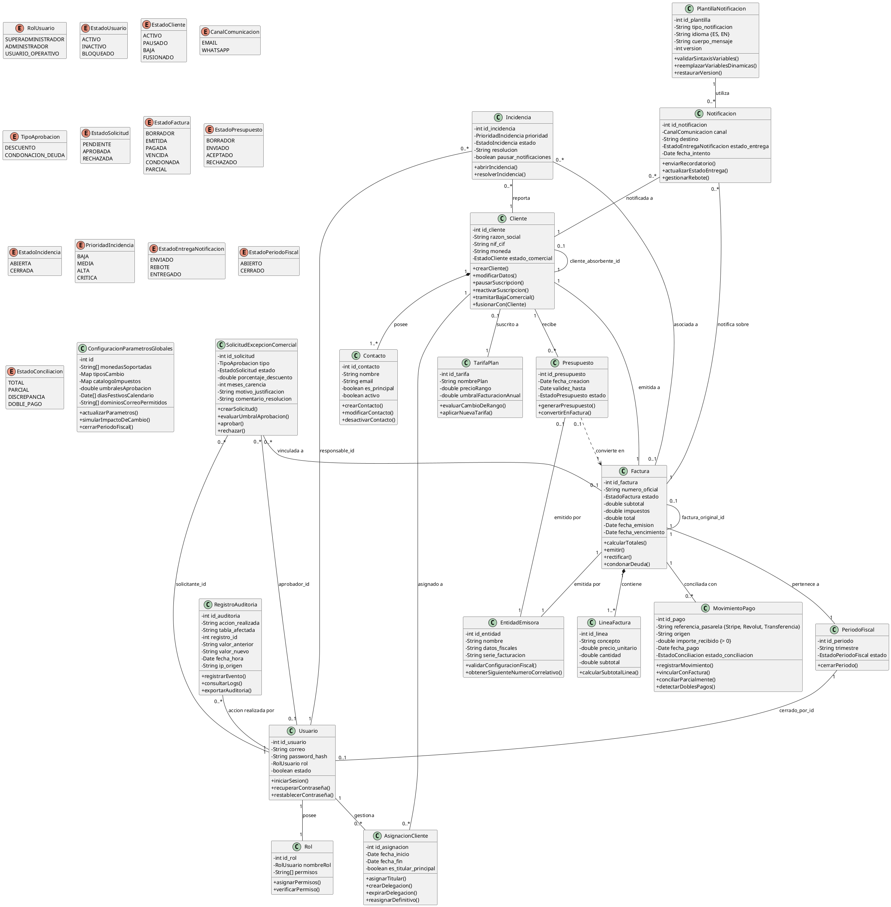

# Entrega 2 · Diseño del sistema

**Asignatura:** Análisis y Diseño de Aplicaciones · Grupo A · 2026–27  
**Equipo:** Gatitos  
**Integrantes:** | Miguel Gutiérrez Toledano, Manuel Farfán Fernández, Míriam Jiménez Acosta, Patricia Frochoso García, Jian Hao Pan Zheng, Carlos Martín Ruiz.   
**Fecha:** 27/11/2026  
**Repositorio:** [\[GATITOS\]](https://github.com/itsGuty/gatitos/)


**Nota: Las documentaciones están en archivos separados, ya que romperían el formato del archivo por completo si los insertamos directamente aquí.**

## 1. Introducción y alcance

En esta entrega hemos diseñado los diagramas de clases, arquitectura, secuencia y datos de nuestra plataforma FacturbineH.

## 2. Actualizaciones de la Entrega 1

Incorporad un resumen y el contenido pertinente de `cambios_entrega1.md`. Indicad qué requisitos o casos de uso cambiaron y por qué. El informe completo actualizado de Entrega 1 se entrega en un PDF separado.

## 3. Modelo físico de datos (Entidad–Relación)

```plantuml
@startuml
' ==========================================
' ESTILO VISUAL ATRACTIVO Y LEGIBLE
' ==========================================
hide circle
scale 1.0
skinparam dpi 150
skinparam shadowing false
skinparam roundcorner 8
skinparam nodesep 45
skinparam ranksep 65
skinparam backgroundColor #FFFFFF

skinparam defaultFontName "DejaVu Sans, Arial, Helvetica, sans-serif"
skinparam defaultFontSize 11

skinparam class {
  BackgroundColor #F8FAFC
  BorderColor #334155
  BorderThickness 1.3
  ArrowColor #0F766E
  ArrowThickness 1.4
  FontColor #0F172A
  HeaderBackgroundColor #1E3A8A
  HeaderFontColor #FFFFFF
  HeaderFontStyle bold
  AttributeFontColor #1E293B
  AttributeFontSize 10
}

skinparam note {
  BackgroundColor #FEF3C7
  BorderColor #D97706
  FontColor #78350F
  FontSize 10
}

title Diseño Físico Entidad-Relación (ER) — FACTURBINEH

' ==========================================
' 1. SEGURIDAD Y CONTROL DE ACCESO (CU-01 a CU-04)
' ==========================================

entity "ROL" as rol #EFF6FF {
  * id_rol : INT <<PK, AUTO_INCREMENT>>
  --
  * nombre_rol : VARCHAR(30) <<UNIQUE>>
  * permisos_json : TEXT
}

entity "USUARIO" as usuario #EFF6FF {
  * id_usuario : INT <<PK, AUTO_INCREMENT>>
  --
  * id_rol : INT <<FK>>
  * nombre : VARCHAR(100)
  * apellidos : VARCHAR(150)
  * correo_corporativo : VARCHAR(150) <<UNIQUE>>
  * password_hash : VARCHAR(255)
  * estado : VARCHAR(20)
  * intentos_fallidos : INT
  token_recuperacion : VARCHAR(255)
  expiracion_token : TIMESTAMP
}

' ==========================================
' 2. GESTIÓN COMERCIAL Y CLIENTES (CU-04 a CU-10)
' ==========================================

entity "TARIFA_PLAN" as tarifa #F0FDFA {
  * id_tarifa : INT <<PK, AUTO_INCREMENT>>
  --
  * nombre_plan : VARCHAR(100)
  * precio_rango : DECIMAL(10,2)
  * umbral_facturacion_anual : DECIMAL(12,2)
}

entity "CLIENTE" as cliente #F0FDFA {
  * id_cliente : INT <<PK, AUTO_INCREMENT>>
  --
  id_tarifa : INT <<FK>>
  id_cliente_absorbente : INT <<FK>>
  * razon_social : VARCHAR(150)
  nombre_comercial : VARCHAR(150)
  * identificador_fiscal : VARCHAR(50) <<UNIQUE>>
  * domicilio_fiscal : TEXT
  * pais : VARCHAR(50)
  * moneda_habitual : VARCHAR(3)
  * vencimiento_defecto_dias : INT
  sector : VARCHAR(100)
  etiquetas : VARCHAR(255)
  * estado_comercial : VARCHAR(30)
  * es_duplicado_falso : BOOLEAN
  fecha_inicio_pausa : DATE
  fecha_fin_pausa : DATE
  motivo_pausa : TEXT
}

entity "ASIGNACION_CLIENTE" as asignacion #F0FDFA {
  * id_asignacion : INT <<PK, AUTO_INCREMENT>>
  --
  * id_cliente : INT <<FK>>
  * id_usuario : INT <<FK>>
  * fecha_inicio : DATE
  fecha_fin : DATE
  * es_titular_principal : BOOLEAN
}

entity "CONTACTO" as contacto #F0FDFA {
  * id_contacto : INT <<PK, AUTO_INCREMENT>>
  --
  * id_cliente : INT <<FK>>
  * nombre : VARCHAR(100)
  cargo : VARCHAR(100)
  * email : VARCHAR(150)
  telefono : VARCHAR(30)
  * canales_autorizados : VARCHAR(50)
  * es_principal_facturacion : BOOLEAN
  * activo : BOOLEAN
}

' ==========================================
' 3. MOTOR DE FACTURACIÓN Y CONTABILIDAD (CU-12 a CU-15, CU-26)
' ==========================================

entity "ENTIDAD_EMISORA" as emisora #EEF2FF {
  * id_entidad : INT <<PK, AUTO_INCREMENT>>
  --
  * razon_social : VARCHAR(150)
  * nif : VARCHAR(50) <<UNIQUE>>
  * datos_fiscales : TEXT
  * serie_ordinaria : VARCHAR(15)
  * serie_rectificativa : VARCHAR(15)
  * plantilla_visual_ref : VARCHAR(255)
  * activa : BOOLEAN
}

entity "PERIODO_FISCAL" as periodo #EEF2FF {
  * id_periodo : INT <<PK, AUTO_INCREMENT>>
  --
  id_usuario_cierre : INT <<FK>>
  * trimestre : VARCHAR(10) <<UNIQUE>>
  * fecha_inicio : DATE
  * fecha_fin : DATE
  * estado : VARCHAR(20)
  fecha_cierre : TIMESTAMP
}

entity "PRESUPUESTO" as presupuesto #EEF2FF {
  * id_presupuesto : INT <<PK, AUTO_INCREMENT>>
  --
  * id_cliente : INT <<FK>>
  * id_entidad_emisora : INT <<FK>>
  * fecha_creacion : DATE
  * validez_hasta : DATE
  * estado : VARCHAR(20)
  * total_estimado : DECIMAL(10,2)
}

entity "LINEA_PRESUPUESTO" as linea_presupuesto #EEF2FF {
  * id_linea_presupuesto : INT <<PK, AUTO_INCREMENT>>
  --
  * id_presupuesto : INT <<FK>>
  * concepto : VARCHAR(255)
  * cantidad : DECIMAL(10,2)
  * precio_unitario : DECIMAL(10,2)
  * descuento_aplicado : DECIMAL(5,2)
  * porcentaje_impuesto : DECIMAL(5,2)
  * subtotal_linea : DECIMAL(10,2)
}

entity "FACTURA" as factura #EEF2FF {
  * id_factura : INT <<PK, AUTO_INCREMENT>>
  --
  * id_cliente : INT <<FK>>
  * id_entidad_emisora : INT <<FK>>
  * id_periodo : INT <<FK>>
  id_presupuesto_origen : INT <<FK>>
  id_factura_original : INT <<FK>>
  * serie : VARCHAR(15)
  * numero_correlativo : VARCHAR(50) <<UNIQUE>>
  * tipo_factura : VARCHAR(20)
  * estado : VARCHAR(30)
  * moneda : VARCHAR(3)
  * subtotal : DECIMAL(10,2)
  * impuestos_totales : DECIMAL(10,2)
  * importe_total : DECIMAL(10,2)
  * fecha_emision : DATE
  * fecha_vencimiento : DATE
  motivo_perdon_deuda : TEXT
  ruta_pdf_generado : VARCHAR(255)
}

entity "LINEA_FACTURA" as linea_factura #EEF2FF {
  * id_linea : INT <<PK, AUTO_INCREMENT>>
  --
  * id_factura : INT <<FK>>
  * concepto : VARCHAR(255)
  * cantidad : DECIMAL(10,2)
  * precio_unitario : DECIMAL(10,2)
  * descuento_aplicado : DECIMAL(5,2)
  * porcentaje_impuesto : DECIMAL(5,2)
  * subtotal_linea : DECIMAL(10,2)
}

' ==========================================
' 4. COBROS, APROBACIONES E INCIDENCIAS (CU-11, CU-16 a CU-18)
' ==========================================

entity "MOVIMIENTO_PAGO" as pago #FFFBEB {
  * id_pago : INT <<PK, AUTO_INCREMENT>>
  --
  * id_factura : INT <<FK>>
  * referencia_pasarela : VARCHAR(100) <<UNIQUE>>
  * origen : VARCHAR(30)
  * importe_recibido : DECIMAL(10,2)
  * fecha_cobro : TIMESTAMP
  * estado_conciliacion : VARCHAR(30)
}

entity "SOLICITUD_APROBACION" as solicitud #FFFBEB {
  * id_solicitud : INT <<PK, AUTO_INCREMENT>>
  --
  * id_cliente : INT <<FK>>
  id_factura : INT <<FK>>
  * id_solicitante : INT <<FK>>
  id_aprobador : INT <<FK>>
  * tipo_solicitud : VARCHAR(30)
  * estado : VARCHAR(20)
  porcentaje_descuento : DECIMAL(5,2)
  meses_carencia : INT
  * motivo_justificacion : TEXT
  comentario_resolucion : TEXT
  * fecha_solicitud : TIMESTAMP
  fecha_resolucion : TIMESTAMP
}

entity "INCIDENCIA" as incidencia #FFFBEB {
  * id_incidencia : INT <<PK, AUTO_INCREMENT>>
  --
  * id_cliente : INT <<FK>>
  id_factura : INT <<FK>>
  * id_responsable : INT <<FK>>
  * prioridad : VARCHAR(20)
  * estado : VARCHAR(20)
  * descripcion : TEXT
  * pausar_notificaciones_cobro : BOOLEAN
  resolucion : TEXT
  * fecha_apertura : TIMESTAMP
  fecha_cierre : TIMESTAMP
}

' ==========================================
' 5. NOTIFICACIONES, AUDITORÍA Y PARÁMETROS (CU-19 a CU-26)
' ==========================================

entity "PLANTILLA_NOTIFICACION" as plantilla #FDF2F8 {
  * id_plantilla : INT <<PK, AUTO_INCREMENT>>
  --
  * tipo_notificacion : VARCHAR(50)
  * idioma : VARCHAR(5)
  * cuerpo_mensaje : TEXT
  * version : INT
  * activa : BOOLEAN
}

entity "NOTIFICACION" as notificacion #FDF2F8 {
  * id_notificacion : INT <<PK, AUTO_INCREMENT>>
  --
  * id_plantilla : INT <<FK>>
  * id_contacto : INT <<FK>>
  * id_cliente : INT <<FK>>
  id_factura : INT <<FK>>
  * canal : VARCHAR(20)
  * destino : VARCHAR(150)
  * estado_entrega : VARCHAR(20)
  * fecha_intento : TIMESTAMP
}

entity "REGISTRO_AUDITORIA" as auditoria #F1F5F9 {
  * id_auditoria : INT <<PK, AUTO_INCREMENT>>
  --
  id_usuario : INT <<FK>>
  * accion_realizada : VARCHAR(150)
  * tabla_afectada : VARCHAR(50)
  * registro_id : INT
  valor_anterior : TEXT
  valor_nuevo : TEXT
  * ip_origen : VARCHAR(45)
  * fecha_hora : TIMESTAMP
}

entity "CONFIGURACION_GLOBAL" as config #F1F5F9 {
  * id_config : INT <<PK, AUTO_INCREMENT>>
  --
  * clave_parametro : VARCHAR(100) <<UNIQUE>>
  * valor_parametro : TEXT
  descripcion : VARCHAR(255)
  * fecha_ultima_modificacion : TIMESTAMP
}

' ==========================================
' RELACIONES Y CARDINALIDADES FÍSICAS
' ==========================================

rol ||--o{ usuario : "define permisos de"
usuario ||--o{ asignacion : "gestiona"
cliente ||--o{ asignacion : "asignado en"

tarifa ||--o{ cliente : "aplica a"
cliente ||--|{ contacto : "posee (mín. 1)"
cliente |o--o| cliente : "absorbe duplicado"

cliente ||--o{ presupuesto : "solicita"
emisora ||--o{ presupuesto : "emite"
presupuesto ||--|{ linea_presupuesto : "desglosa"
presupuesto |o--o| factura : "se convierte en"

cliente ||--o{ factura : "recibe"
emisora ||--o{ factura : "emite"
periodo ||--o{ factura : "agrupa"
usuario |o--o{ periodo : "cierra"
factura ||--|{ linea_factura : "contiene (mín. 1)"
factura |o--o| factura : "rectifica a"

factura ||--o{ pago : "se salda con"

cliente ||--o{ solicitud : "afecta a"
factura |o--o{ solicitud : "vinculada a"
usuario ||--o{ solicitud : "crea (solicitante)"
usuario |o--o{ solicitud : "resuelve (aprobador)"

cliente ||--o{ incidencia : "genera"
factura |o--o{ incidencia : "disputada en"
usuario ||--o{ incidencia : "atiende"

plantilla ||--o{ notificacion : "formatea"
contacto ||--o{ notificacion : "recibe"
cliente ||--o{ notificacion : "asociada a"
factura |o--o{ notificacion : "reclama"

usuario |o--o{ auditoria : "ejecuta acción"

@enduml
```



## 4. Diagrama UML de clases



## 5. Diagramas UML de secuencia

```plantuml
@startuml
title SD-00: Validación de Sesión JWT y Autorización RBAC
autonumber

skinparam sequence {
    ArrowColor #FF7B29
    LifeLineBorderColor #1E212B
    LifeLineBackgroundColor #FF7B29
    ActorBorderColor #1E212B
    ParticipantBorderColor #1E212B
    ParticipantBackgroundColor #1E212B
    ParticipantFontColor #FFFFFF
    DatabaseBorderColor #1E212B
    DatabaseBackgroundColor #1E212B
    DatabaseFontColor #FFFFFF
    GroupBorderColor #1E212B
    GroupBackgroundColor #F4F5F7
}

participant ": PanelWeb" as FE
participant ": RBACGuard" as RBAC
participant ": SessionManager" as SessionMgr
database ": PostgreSQL" as DB

FE -> RBAC : peticionAPI(jwt: String, rolRequerido: Rol, payload: Object)
activate RBAC

RBAC -> SessionMgr : validarSesionYRol(jwt: String, rolRequerido: Rol)
activate SessionMgr
SessionMgr -> DB : verificarTokenYPermisos(jwt: String)
activate DB
DB --> SessionMgr : sesion: SesionActivaDTO
deactivate DB

alt Token válido y rol autorizado (Superadmin / Admin / Operativo)
    SessionMgr --> RBAC : autorizado: Boolean = true
    deactivate SessionMgr
    note right of RBAC : Continúa la ejecución del Caso de Uso
    deactivate RBAC
else Token inválido, expirado o rol insuficiente
    SessionMgr --> RBAC : errorAcceso: ForbiddenException
    deactivate SessionMgr
    RBAC --> FE : 403 Forbidden (mensaje: String)
    deactivate RBAC
end
@enduml

```plantuml```

@startuml
title CU-01: Iniciar Sesión en la Plataforma
autonumber


skinparam sequence {
    ArrowColor #FF7B29
    LifeLineBorderColor #1E212B
    LifeLineBackgroundColor #FF7B29
    ActorBorderColor #1E212B
    ParticipantBorderColor #1E212B
    ParticipantBackgroundColor #1E212B
    ParticipantFontColor #FFFFFF
    DatabaseBorderColor #1E212B
    DatabaseBackgroundColor #1E212B
    DatabaseFontColor #FFFFFF
    GroupBorderColor #1E212B
    GroupBackgroundColor #F4F5F7
}


actor ": Operativo" as U
participant ": PanelWeb" as FE
participant ": AuthController" as AuthCtrl
participant ": SessionManager" as SessionMgr
database ": PostgreSQL" as DB


U -> FE : iniciarSesion(email: String, password: String)
activate FE
FE -> AuthCtrl : login(email: String, password: String)
activate AuthCtrl


AuthCtrl -> SessionMgr : validarCredencialesYBloqueo(email: String, password: String)
activate SessionMgr
SessionMgr -> DB : obtenerUsuarioPorEmail(email: String)
activate DB
DB --> SessionMgr : datosUsuario: UsuarioRecord
deactivate DB


alt Credenciales válidas y cuenta no bloqueada
    create participant ": Usuario" as Usr
    SessionMgr -->> Usr : Usuario(datosUsuario)


    SessionMgr -> SessionMgr : generarTokenJWT(Usr)
    SessionMgr -> DB : registrarSesionActiva(Usr.id, tokenJWT: String)
    activate DB
    DB --> SessionMgr : ok: Boolean
    deactivate DB


    SessionMgr --> AuthCtrl : sesion: SesionDTO
    deactivate SessionMgr
    AuthCtrl --> FE : 200 OK (sesion: SesionDTO)
    deactivate AuthCtrl
    FE -> FE : almacenarTokenJWT(sesion.token)
    FE --> U : mostrarDashboard()
    deactivate FE
else Credenciales incorrectas o cuenta bloqueada
    SessionMgr -> DB : actualizarIntentosYBloqueo(email: String)
    activate DB
    DB --> SessionMgr : bloqueado: Boolean
    deactivate DB


    SessionMgr --> AuthCtrl : errorAutenticacion: AuthException
    deactivate SessionMgr
    AuthCtrl --> FE : 401 Unauthorized (mensaje: String)
    deactivate AuthCtrl
    FE --> U : mostrarError("Credenciales inválidas o cuenta bloqueada")
    deactivate FE
end
@enduml

@startuml
title CU-02: Recuperar y Restablecer Contraseña
autonumber


skinparam sequence {
    ArrowColor #FF7B29
    LifeLineBorderColor #1E212B
    LifeLineBackgroundColor #FF7B29
    ActorBorderColor #1E212B
    ParticipantBorderColor #1E212B
    ParticipantBackgroundColor #1E212B
    ParticipantFontColor #FFFFFF
    DatabaseBorderColor #1E212B
    DatabaseBackgroundColor #1E212B
    DatabaseFontColor #FFFFFF
    GroupBorderColor #1E212B
    GroupBackgroundColor #F4F5F7
}


actor ": Operativo" as U
participant ": PanelWeb" as FE
participant ": AuthController" as AuthCtrl
participant ": SessionManager" as SessionMgr
database ": PostgreSQL" as DB


== Fase 1: Solicitud de Token de Recuperación ==
U -> FE : solicitarRecuperacion(email: String)
activate FE
FE -> AuthCtrl : iniciarRecuperacion(email: String)
activate AuthCtrl
AuthCtrl -> SessionMgr : generarTokenRecuperacion(email: String)
activate SessionMgr
SessionMgr -> DB : verificarUsuarioActivo(email: String)
activate DB
DB --> SessionMgr : usuarioId: UUID
deactivate DB
SessionMgr -> DB : guardarTokenTemporal(usuarioId: UUID, expiracion: DateTime)
activate DB
DB --> SessionMgr : tokenRecuperacion: String
deactivate DB
SessionMgr --> AuthCtrl : resultado: Boolean
deactivate SessionMgr
AuthCtrl --> FE : 200 OK (confirmacion: String)
deactivate AuthCtrl
FE --> U : mostrarConfirmacion("Solicitud procesada")
deactivate FE


== Fase 2: Restablecimiento de Credenciales ==
U -> FE : introducirNuevaPassword(token: String, nuevaPassword: String)
activate FE
FE -> AuthCtrl : restablecerCredenciales(token: String, nuevaPassword: String)
activate AuthCtrl
AuthCtrl -> SessionMgr : validarYActualizarPassword(token: String, nuevaPassword: String)
activate SessionMgr
SessionMgr -> DB : validarTokenTemporal(token: String)
activate DB
DB --> SessionMgr : estadoToken: Boolean
deactivate DB


alt Token válido y vigente
    SessionMgr -> DB : actualizarHashYDesbloquear(token: String, hash: String)
    activate DB
    DB --> SessionMgr : ok: Boolean
    deactivate DB
    SessionMgr --> AuthCtrl : actualizado: Boolean
    deactivate SessionMgr
    AuthCtrl --> FE : 200 OK
    deactivate AuthCtrl
    FE --> U : redirigirALogin()
    deactivate FE
else Token inválido o expirado
    SessionMgr --> AuthCtrl : errorToken: AuthException
    deactivate SessionMgr
    AuthCtrl --> FE : 400 Bad Request
    deactivate AuthCtrl
    FE --> U : mostrarError("Token inválido o caducado")
    deactivate FE
end
@enduml

@startuml
title CU-03: Gestión de Usuarios y Roles
autonumber


skinparam sequence {
    ArrowColor #FF7B29
    LifeLineBorderColor #1E212B
    LifeLineBackgroundColor #FF7B29
    ActorBorderColor #1E212B
    ParticipantBorderColor #1E212B
    ParticipantBackgroundColor #1E212B
    ParticipantFontColor #FFFFFF
    DatabaseBorderColor #1E212B
    DatabaseBackgroundColor #1E212B
    DatabaseFontColor #FFFFFF
    GroupBorderColor #1E212B
    GroupBackgroundColor #F4F5F7
}


actor ": Admin" as Admin
participant ": PanelWeb" as FE
participant ": RBACGuard" as RBAC
participant ": SessionManager" as SessionMgr
participant ": ConfigApr" as ConfigApr
participant ": AuditService" as AuditSvc
database ": PostgreSQL" as DB


Admin -> FE : guardarUsuarioYRol(jwt: String, datosUsuario: UsuarioDTO)
activate FE


ref over FE, SessionMgr : SD-00: Validar Sesión JWT y Rol ("Admin")


activate RBAC
RBAC -> ConfigApr : gestionarUsuarioYRol(datosUsuario: UsuarioDTO)
activate ConfigApr


create participant ": Usuario" as Usr
ConfigApr -->> Usr : Usuario(datosUsuario)


ConfigApr -> DB : insertarOActualizarUsuario(Usr)
activate DB
DB --> ConfigApr : usuarioGuardado: Usuario
deactivate DB


ConfigApr ->> AuditSvc : registrarEventoConfig(evento: "GESTION_USUARIO_ROL", usuarioGuardado.id)
activate AuditSvc
AuditSvc -> DB : insertarAuditoria(evento: AuditEvent)
activate DB
DB --> AuditSvc : ok: Boolean
deactivate DB
deactivate AuditSvc


ConfigApr --> RBAC : resultado: UsuarioDTO
deactivate ConfigApr
RBAC --> FE : 200 OK (resultado: UsuarioDTO)
deactivate RBAC
FE --> Admin : mostrarConfirmacionUsuario()
deactivate FE
@enduml

@startuml
title CU-04: Asignación y Delegación Temporal de Clientes
autonumber


skinparam sequence {
    ArrowColor #FF7B29
    LifeLineBorderColor #1E212B
    LifeLineBackgroundColor #FF7B29
    ActorBorderColor #1E212B
    ParticipantBorderColor #1E212B
    ParticipantBackgroundColor #1E212B
    ParticipantFontColor #FFFFFF
    DatabaseBorderColor #1E212B
    DatabaseBackgroundColor #1E212B
    DatabaseFontColor #FFFFFF
    GroupBorderColor #1E212B
    GroupBackgroundColor #F4F5F7
}


actor ": Admin" as Admin
participant ": PanelWeb" as FE
participant ": RBACGuard" as RBAC
participant ": SessionManager" as SessionMgr
participant ": GestorCLI" as GestorCLI
participant ": AuditService" as AuditSvc
database ": PostgreSQL" as DB


Admin -> FE : asignarCliente(jwt: String, clienteId: UUID, operativoId: UUID, fechaFin: Date)
activate FE


ref over FE, SessionMgr : SD-00: Validar Sesión JWT y Rol ("Admin")


activate RBAC
RBAC -> GestorCLI : asignarCliente(clienteId: UUID, operativoId: UUID, fechaFin: Date)
activate GestorCLI
GestorCLI -> DB : actualizarAsignacionYDelegacion(clienteId: UUID, operativoId: UUID, fechaFin: Date)
activate DB
DB --> GestorCLI : ok: Boolean
deactivate DB


GestorCLI ->> AuditSvc : registrarEventoCliente(evento: "ASIGNACION_CLIENTE", clienteId: UUID)
activate AuditSvc
AuditSvc -> DB : insertarAuditoria(evento: AuditEvent)
activate DB
DB --> AuditSvc : ok: Boolean
deactivate DB
deactivate AuditSvc


GestorCLI --> RBAC : asignacionConfirmada: Boolean
deactivate GestorCLI
RBAC --> FE : 200 OK
deactivate RBAC
FE --> Admin : actualizarCarteraClientes()
deactivate FE
@enduml

@startuml
title CU-05: Alta de Nuevo Cliente y Registro Comercial
autonumber


skinparam sequence {
    ArrowColor #FF7B29
    LifeLineBorderColor #1E212B
    LifeLineBackgroundColor #FF7B29
    ActorBorderColor #1E212B
    ParticipantBorderColor #1E212B
    ParticipantBackgroundColor #1E212B
    ParticipantFontColor #FFFFFF
    DatabaseBorderColor #1E212B
    DatabaseBackgroundColor #1E212B
    DatabaseFontColor #FFFFFF
    GroupBorderColor #1E212B
    GroupBackgroundColor #F4F5F7
}


actor ": Operativo" as Op
participant ": PanelWeb" as FE
participant ": RBACGuard" as RBAC
participant ": SessionManager" as SessionMgr
participant ": GestorCLI" as GestorCLI
participant ": SrvFact" as SrvFact
participant ": AuditService" as AuditSvc
database ": PostgreSQL" as DB


Op -> FE : registrarCliente(jwt: String, datosCliente: ClienteDTO)
activate FE


ref over FE, SessionMgr : SD-00: Validar Sesión JWT y Rol ("Operativo")


activate RBAC
RBAC -> GestorCLI : crearCliente(datosCliente: ClienteDTO)
activate GestorCLI
GestorCLI -> DB : validarDuplicidadNIF(datosCliente.nif)
activate DB
DB --> GestorCLI : disponible: Boolean
deactivate DB


alt Datos válidos y NIF disponible
    create participant ": Cliente" as Cli
    GestorCLI -->> Cli : Cliente(datosCliente)


    GestorCLI -> DB : insertarClienteTarifaYAsignacion(Cli)
    activate DB
    DB --> GestorCLI : clienteCreado: Cliente
    deactivate DB


    GestorCLI -> SrvFact : notificarImpactoContable(clienteCreado.id, datosCliente.tarifa)
    activate SrvFact
    SrvFact -> DB : inicializarCuentaContableCliente(clienteCreado.id)
    activate DB
    DB --> SrvFact : ok: Boolean
    deactivate DB
    SrvFact --> GestorCLI : impactoRegistrado: Boolean
    deactivate SrvFact


    GestorCLI ->> AuditSvc : registrarEventoCliente(evento: "ALTA_CLIENTE", clienteCreado.id)
    activate AuditSvc
    AuditSvc -> DB : insertarAuditoria(evento: AuditEvent)
    activate DB
    DB --> AuditSvc : ok: Boolean
    deactivate DB
    deactivate AuditSvc


    GestorCLI --> RBAC : clienteCreado: Cliente
    deactivate GestorCLI
    RBAC --> FE : 201 Created (clienteCreado: Cliente)
    deactivate RBAC
    FE --> Op : mostrarFichaCliente(clienteCreado)
    deactivate FE
else NIF duplicado o datos inválidos
    GestorCLI --> RBAC : errorValidacion: ValidationException
    deactivate GestorCLI
    RBAC --> FE : 400 Bad Request
    deactivate RBAC
    FE --> Op : mostrarErroresFormulario()
    deactivate FE
end
@enduml

@startuml
title CU-06: Gestión de Contactos e Información Fiscal
autonumber


skinparam sequence {
    ArrowColor #FF7B29
    LifeLineBorderColor #1E212B
    LifeLineBackgroundColor #FF7B29
    ActorBorderColor #1E212B
    ParticipantBorderColor #1E212B
    ParticipantBackgroundColor #1E212B
    ParticipantFontColor #FFFFFF
    DatabaseBorderColor #1E212B
    DatabaseBackgroundColor #1E212B
    DatabaseFontColor #FFFFFF
    GroupBorderColor #1E212B
    GroupBackgroundColor #F4F5F7
}


actor ": Operativo" as Op
participant ": PanelWeb" as FE
participant ": RBACGuard" as RBAC
participant ": SessionManager" as SessionMgr
participant ": GestorCLI" as GestorCLI
participant ": AuditService" as AuditSvc
database ": PostgreSQL" as DB


Op -> FE : actualizarDatosFiscalesYContactos(jwt: String, clienteId: UUID, datos: ContactoFiscalDTO)
activate FE


ref over FE, SessionMgr : SD-00: Validar Sesión JWT y Rol ("Operativo")


activate RBAC
RBAC -> GestorCLI : actualizarContactoYFiscalidad(clienteId: UUID, datos: ContactoFiscalDTO)
activate GestorCLI
GestorCLI -> DB : comprobarConflictosEmailYNIF(clienteId: UUID, datos: ContactoFiscalDTO)
activate DB
DB --> GestorCLI : sinConflictos: Boolean
deactivate DB


alt Datos válidos y sin conflictos
    GestorCLI -> DB : actualizarClienteYContactos(clienteId: UUID, datos: ContactoFiscalDTO)
    activate DB
    DB --> GestorCLI : actualizado: Boolean
    deactivate DB


    GestorCLI ->> AuditSvc : registrarEventoCliente(evento: "ACTUALIZACION_FISCAL_CONTACTO", clienteId: UUID)
    activate AuditSvc
    AuditSvc -> DB : insertarAuditoria(evento: AuditEvent)
    activate DB
    DB --> AuditSvc : ok: Boolean
    deactivate DB
    deactivate AuditSvc


    GestorCLI --> RBAC : ok: Boolean
    deactivate GestorCLI
    RBAC --> FE : 200 OK
    deactivate RBAC
    FE --> Op : mostrarNotificacionExito()
    deactivate FE
else Conflicto de email o NIF
    GestorCLI --> RBAC : errorConflicto: ConflictException
    deactivate GestorCLI
    RBAC --> FE : 409 Conflict
    deactivate RBAC
    FE --> Op : mostrarErrorConflicto()
    deactivate FE
end
@enduml

@startuml
title CU-07: Pausa Temporal y Reactivación de Suscripción
autonumber


skinparam sequence {
    ArrowColor #FF7B29
    LifeLineBorderColor #1E212B
    LifeLineBackgroundColor #FF7B29
    ActorBorderColor #1E212B
    ParticipantBorderColor #1E212B
    ParticipantBackgroundColor #1E212B
    ParticipantFontColor #FFFFFF
    DatabaseBorderColor #1E212B
    DatabaseBackgroundColor #1E212B
    DatabaseFontColor #FFFFFF
    GroupBorderColor #1E212B
    GroupBackgroundColor #F4F5F7
}


actor ": Admin" as Admin
participant ": PanelWeb" as FE
participant ": RBACGuard" as RBAC
participant ": SessionManager" as SessionMgr
participant ": GestorCLI" as GestorCLI
participant ": SrvFact" as SrvFact
participant ": PayAdp" as PayAdp
participant ": AuditService" as AuditSvc
database ": PostgreSQL" as DB


Admin -> FE : cambiarEstadoSuscripcion(jwt: String, clienteId: UUID, nuevoEstado: EstadoSuscripcion)
activate FE


ref over FE, SessionMgr : SD-00: Validar Sesión JWT y Rol ("Admin")


activate RBAC
RBAC -> GestorCLI : cambiarEstadoSuscripcion(clienteId: UUID, nuevoEstado: EstadoSuscripcion)
activate GestorCLI
GestorCLI -> DB : actualizarEstadoCliente(clienteId: UUID, nuevoEstado: EstadoSuscripcion)
activate DB
DB --> GestorCLI : suscripcionExternaId: String
deactivate DB


GestorCLI -> SrvFact : aplicarImpactoContableSuscripcion(clienteId: UUID, nuevoEstado: EstadoSuscripcion)
activate SrvFact
SrvFact -> PayAdp : gestionarSuscripcionExterna(suscripcionExternaId: String, nuevoEstado: EstadoSuscripcion)
activate PayAdp
PayAdp --> SrvFact : estadoPasarela: String
deactivate PayAdp
SrvFact --> GestorCLI : sincronizado: Boolean
deactivate SrvFact


GestorCLI ->> AuditSvc : registrarEventoCliente(evento: "CAMBIO_ESTADO_SUSCRIPCION", clienteId: UUID)
activate AuditSvc
AuditSvc -> DB : insertarAuditoria(evento: AuditEvent)
activate DB
DB --> AuditSvc : ok: Boolean
deactivate DB
deactivate AuditSvc


GestorCLI --> RBAC : estadoActualizado: EstadoSuscripcion
deactivate GestorCLI
RBAC --> FE : 200 OK (estadoActualizado: EstadoSuscripcion)
deactivate RBAC
FE --> Admin : actualizarEstadoEnUI()
deactivate FE
@enduml

@startuml
title CU-08: Tramitar Baja Comercial y Anonimización
autonumber


skinparam sequence {
    ArrowColor #FF7B29
    LifeLineBorderColor #1E212B
    LifeLineBackgroundColor #FF7B29
    ActorBorderColor #1E212B
    ParticipantBorderColor #1E212B
    ParticipantBackgroundColor #1E212B
    ParticipantFontColor #FFFFFF
    DatabaseBorderColor #1E212B
    DatabaseBackgroundColor #1E212B
    DatabaseFontColor #FFFFFF
    GroupBorderColor #1E212B
    GroupBackgroundColor #F4F5F7
}


actor ": Admin" as Admin
participant ": PanelWeb" as FE
participant ": RBACGuard" as RBAC
participant ": SessionManager" as SessionMgr
participant ": GestorCLI" as GestorCLI
participant ": SrvFact" as SrvFact
participant ": PayAdp" as PayAdp
participant ": AuditService" as AuditSvc
database ": PostgreSQL" as DB


Admin -> FE : confirmarBajaDefinitiva(jwt: String, clienteId: UUID)
activate FE


ref over FE, SessionMgr : SD-00: Validar Sesión JWT y Rol ("Admin")


activate RBAC
RBAC -> GestorCLI : tramitarBajaYAnonimizacion(clienteId: UUID)
activate GestorCLI
GestorCLI -> SrvFact : verificarDeudasPendientes(clienteId: UUID)
activate SrvFact
SrvFact -> DB : consultarFacturasImpagadas(clienteId: UUID)
activate DB
DB --> SrvFact : totalDeuda: Decimal
deactivate DB
SrvFact --> GestorCLI : tieneDeudas: Boolean
deactivate SrvFact


alt Existen deudas pendientes
    GestorCLI --> RBAC : errorDeudaPendiente: BusinessException
    deactivate GestorCLI
    RBAC --> FE : 422 Unprocessable Entity
    deactivate RBAC
    FE --> Admin : mostrarError("No se puede tramitar baja con deudas pendientes")
    deactivate FE
else Sin deudas pendientes
    GestorCLI -> SrvFact : cancelarSuscripcionPorBaja(clienteId: UUID)
    activate SrvFact
    SrvFact -> PayAdp : cancelarSuscripcion(clienteId: UUID)
    activate PayAdp
    PayAdp --> SrvFact : cancelada: Boolean
    deactivate PayAdp
    SrvFact --> GestorCLI : ok: Boolean
    deactivate SrvFact


    GestorCLI -> DB : anonimizarPIIYBajaLogica(clienteId: UUID)
    activate DB
    DB --> GestorCLI : bajaCompletada: Boolean
    deactivate DB


    GestorCLI ->> AuditSvc : registrarEventoCliente(evento: "BAJA_Y_ANONIMIZACION_GDPR", clienteId: UUID)
    activate AuditSvc
    AuditSvc -> DB : insertarAuditoria(evento: AuditEvent)
    activate DB
    DB --> AuditSvc : ok: Boolean
    deactivate DB
    deactivate AuditSvc


    GestorCLI --> RBAC : ok: Boolean
    deactivate GestorCLI
    RBAC --> FE : 200 OK
    deactivate RBAC
    FE --> Admin : redirigirAListadoClientes()
    deactivate FE
end
@enduml

@startuml
title CU-09: Fusión y Control de Clientes Duplicados
autonumber


skinparam sequence {
    ArrowColor #FF7B29
    LifeLineBorderColor #1E212B
    LifeLineBackgroundColor #FF7B29
    ActorBorderColor #1E212B
    ParticipantBorderColor #1E212B
    ParticipantBackgroundColor #1E212B
    ParticipantFontColor #FFFFFF
    DatabaseBorderColor #1E212B
    DatabaseBackgroundColor #1E212B
    DatabaseFontColor #FFFFFF
    GroupBorderColor #1E212B
    GroupBackgroundColor #F4F5F7
}


actor ": Admin" as Admin
participant ": PanelWeb" as FE
participant ": RBACGuard" as RBAC
participant ": SessionManager" as SessionMgr
participant ": GestorCLI" as GestorCLI
participant ": SrvFact" as SrvFact
participant ": AuditService" as AuditSvc
database ": PostgreSQL" as DB


Admin -> FE : fusionarClientes(jwt: String, origenId: UUID, destinoId: UUID)
activate FE


ref over FE, SessionMgr : SD-00: Validar Sesión JWT y Rol ("Admin")


activate RBAC
RBAC -> GestorCLI : fusionarClientes(origenId: UUID, destinoId: UUID)
activate GestorCLI
GestorCLI -> DB : reasignarContactosYMarcarOrigenFusionado(origenId: UUID, destinoId: UUID)
activate DB
DB --> GestorCLI : ok: Boolean
deactivate DB


GestorCLI -> SrvFact : reasignarFacturasPorFusion(origenId: UUID, destinoId: UUID)
activate SrvFact
SrvFact -> DB : transferirFacturasYPresupuestos(origenId: UUID, destinoId: UUID)
activate DB
DB --> SrvFact : ok: Boolean
deactivate DB
SrvFact --> GestorCLI : impactoContableAplicado: Boolean
deactivate SrvFact


GestorCLI ->> AuditSvc : registrarEventoCliente(evento: "FUSION_CLIENTES", origenId: UUID, destinoId: UUID)
activate AuditSvc
AuditSvc -> DB : insertarAuditoria(evento: AuditEvent)
activate DB
DB --> AuditSvc : ok: Boolean
deactivate DB
deactivate AuditSvc


GestorCLI --> RBAC : fusionCompletada: Boolean
deactivate GestorCLI
RBAC --> FE : 200 OK
deactivate RBAC
FE --> Admin : recargarFichaClienteDestino(destinoId)
deactivate FE
@enduml

@startuml
title CU-10: Revisión Anual y Cambio de Rango de Facturación
autonumber


skinparam sequence {
    ArrowColor #FF7B29
    LifeLineBorderColor #1E212B
    LifeLineBackgroundColor #FF7B29
    ParticipantBorderColor #1E212B
    ParticipantBackgroundColor #1E212B
    ParticipantFontColor #FFFFFF
    DatabaseBorderColor #1E212B
    DatabaseBackgroundColor #1E212B
    DatabaseFontColor #FFFFFF
    GroupBorderColor #1E212B
    GroupBackgroundColor #F4F5F7
}


participant ": CronJob" as Cron
participant ": SrvFact" as SrvFact
participant ": GestorNotif" as GestorNotif
participant ": GestorCLI" as GestorCLI
participant ": NotifAdp" as NotifAdp
participant ": AuditService" as AuditSvc
database ": PostgreSQL" as DB


Cron -> SrvFact : ejecutarRevisionAnualTarifas(anio: Integer)
activate SrvFact
SrvFact -> DB : obtenerClientesActivosYFacturacionAnual(anio: Integer)
activate DB
DB --> SrvFact : candidatosCambio: List<CambioTramoDTO>
deactivate DB


loop Por cada cliente con cambio de tramo
    SrvFact -> DB : actualizarTramoCuotaCliente(candidato.clienteId, candidato.nuevoTramo)
    activate DB
    DB --> SrvFact : ok: Boolean
    deactivate DB


    SrvFact -> GestorNotif : notificarCambioCuotaAnual(candidato.clienteId, candidato.nuevoTramo)
    activate GestorNotif
    GestorNotif -> GestorCLI : obtenerContactoYCanales(candidato.clienteId)
    activate GestorCLI
    GestorCLI -> DB : consultarContactosPreferidos(candidato.clienteId)
    activate DB
    DB --> GestorCLI : contacto: ContactoDTO
    deactivate DB
    GestorCLI --> GestorNotif : contacto: ContactoDTO
    deactivate GestorCLI


    GestorNotif ->> NotifAdp : despacharMensaje(contacto: ContactoDTO, plantilla: "CAMBIO_TRAMO")
    GestorNotif -> DB : registrarEnvioNotificacion(candidato.clienteId, "CAMBIO_TRAMO")
    activate DB
    DB --> GestorNotif : ok: Boolean
    deactivate DB
    GestorNotif --> SrvFact : notificado: Boolean
    deactivate GestorNotif
end


SrvFact ->> AuditSvc : registrarEventoFactura(evento: "REVISION_ANUAL_TARIFAS", anio: Integer)
activate AuditSvc
AuditSvc -> DB : insertarAuditoria(evento: AuditEvent)
activate DB
DB --> AuditSvc : ok: Boolean
deactivate DB
deactivate AuditSvc


SrvFact --> Cron : procesoCompletado: Boolean
deactivate SrvFact
@enduml

@startuml
title CU-11: Solicitud y Aprobación de Excepciones Comerciales
autonumber


skinparam sequence {
    ArrowColor #FF7B29
    LifeLineBorderColor #1E212B
    LifeLineBackgroundColor #FF7B29
    ActorBorderColor #1E212B
    ParticipantBorderColor #1E212B
    ParticipantBackgroundColor #1E212B
    ParticipantFontColor #FFFFFF
    DatabaseBorderColor #1E212B
    DatabaseBackgroundColor #1E212B
    DatabaseFontColor #FFFFFF
    GroupBorderColor #1E212B
    GroupBackgroundColor #F4F5F7
}


actor ": Operativo" as Op
actor ": Admin" as Admin
participant ": PanelWeb" as FE
participant ": RBACGuard" as RBAC
participant ": SessionManager" as SessionMgr
participant ": ConfigApr" as ConfigApr
participant ": SrvFact" as SrvFact
participant ": AuditService" as AuditSvc
database ": PostgreSQL" as DB


== Fase 1: Solicitud de Excepción ==
Op -> FE : solicitarExcepcion(jwt: String, clienteId: UUID, datosExcepcion: ExcepcionDTO)
activate FE


ref over FE, SessionMgr : SD-00: Validar Sesión JWT y Rol ("Operativo")


activate RBAC
RBAC -> ConfigApr : crearSolicitudExcepcion(clienteId: UUID, datosExcepcion: ExcepcionDTO)
activate ConfigApr
ConfigApr -> DB : insertarExcepcionPendiente(datosExcepcion: ExcepcionDTO)
activate DB
DB --> ConfigApr : excepcionId: UUID
deactivate DB


ConfigApr ->> AuditSvc : registrarEventoSolicitud(evento: "SOLICITUD_EXCEPCION", excepcionId: UUID)
activate AuditSvc
AuditSvc -> DB : insertarAuditoria(evento: AuditEvent)
activate DB
DB --> AuditSvc : ok: Boolean
deactivate DB
deactivate AuditSvc


ConfigApr --> RBAC : excepcionId: UUID
deactivate ConfigApr
RBAC --> FE : 201 Created (excepcionId: UUID)
deactivate RBAC
FE --> Op : mostrarConfirmacionEnvio()
deactivate FE


== Fase 2: Resolución de Excepción ==
Admin -> FE : resolverExcepcion(jwt: String, excepcionId: UUID, aprobada: Boolean)
activate FE


ref over FE, SessionMgr : SD-00: Validar Sesión JWT y Rol ("Admin")


activate RBAC
RBAC -> ConfigApr : resolverExcepcion(excepcionId: UUID, aprobada: Boolean)
activate ConfigApr
ConfigApr -> DB : actualizarEstadoExcepcion(excepcionId: UUID, aprobada: Boolean)
activate DB
DB --> ConfigApr : excepcion: ExcepcionDTO
deactivate DB


alt Solicitud Aprobada
    ConfigApr -> SrvFact : aplicarExcepcionFacturacion(excepcion: ExcepcionDTO)
    activate SrvFact
    SrvFact -> DB : guardarReglaExcepcionCliente(excepcion: ExcepcionDTO)
    activate DB
    DB --> SrvFact : ok: Boolean
    deactivate DB
    SrvFact --> ConfigApr : aplicada: Boolean
    deactivate SrvFact
end


ConfigApr ->> AuditSvc : registrarEventoSolicitud(evento: "RESOLUCION_EXCEPCION", excepcionId: UUID)
activate AuditSvc
AuditSvc -> DB : insertarAuditoria(evento: AuditEvent)
activate DB
DB --> AuditSvc : ok: Boolean
deactivate DB
deactivate AuditSvc


ConfigApr --> RBAC : resolucionConfirmada: Boolean
deactivate ConfigApr
RBAC --> FE : 200 OK
deactivate RBAC
FE --> Admin : mostrarConfirmacionResolucion()
deactivate FE
@enduml

@startuml
title CU-12: Generación Automática de Facturas Recurrentes
autonumber


skinparam sequence {
    ArrowColor #FF7B29
    LifeLineBorderColor #1E212B
    LifeLineBackgroundColor #FF7B29
    ParticipantBorderColor #1E212B
    ParticipantBackgroundColor #1E212B
    ParticipantFontColor #FFFFFF
    DatabaseBorderColor #1E212B
    DatabaseBackgroundColor #1E212B
    DatabaseFontColor #FFFFFF
    GroupBorderColor #1E212B
    GroupBackgroundColor #F4F5F7
}


participant ": CronJob" as Cron
participant ": SrvFact" as SrvFact
participant ": GenDocs" as GenDocs
participant ": PayAdp" as PayAdp
participant ": GestorNotif" as GestorNotif
participant ": GestorCLI" as GestorCLI
participant ": NotifAdp" as NotifAdp
participant ": AuditService" as AuditSvc
database ": PostgreSQL" as DB
database ": Storage" as Storage


Cron -> SrvFact : ejecutarCicloRecurrente(fecha: Date)
activate SrvFact
SrvFact -> DB : obtenerClientesFacturables(fecha: Date)
activate DB
DB --> SrvFact : clientes: List<ClienteFacturableDTO>
deactivate DB


loop Por cada cliente facturable
    SrvFact -> DB : generarYGuardarFactura(cliente: ClienteFacturableDTO)
    activate DB
    DB --> SrvFact : facturaGuardada: Factura
    deactivate DB


    SrvFact -> GenDocs : emitirDocumentoPDF(facturaGuardada)
    activate GenDocs
    GenDocs -> Storage : guardarArchivoPDF(facturaGuardada.id, contenido: Byte[])
    activate Storage
    Storage --> GenDocs : rutaPDF: String
    deactivate Storage
    GenDocs --> SrvFact : rutaPDF: String
    deactivate GenDocs


    SrvFact -> DB : asociarRutaPDF(facturaGuardada.id, rutaPDF: String)
    activate DB
    DB --> SrvFact : ok: Boolean
    deactivate DB


    alt Cobro automático habilitado
        SrvFact -> PayAdp : gestionarCobro(facturaGuardada)
        activate PayAdp
        PayAdp --> SrvFact : resultadoCobro: EstadoPago
        deactivate PayAdp
        SrvFact -> DB : actualizarEstadoFactura(facturaGuardada.id, resultadoCobro: EstadoPago)
        activate DB
        DB --> SrvFact : ok: Boolean
        deactivate DB
    end


    SrvFact -> GestorNotif : solicitarEnvioFactura(facturaGuardada.id, cliente.id, rutaPDF: String)
    activate GestorNotif
    GestorNotif -> GestorCLI : obtenerContactoYCanales(cliente.id)
    activate GestorCLI
    GestorCLI -> DB : consultarContactosPreferidos(cliente.id)
    activate DB
    DB --> GestorCLI : contacto: ContactoDTO
    deactivate DB
    GestorCLI --> GestorNotif : contacto: ContactoDTO
    deactivate GestorCLI


    GestorNotif ->> NotifAdp : despacharMensaje(contacto: ContactoDTO, rutaPDF: String)
    GestorNotif -> DB : registrarEnvio(facturaGuardada.id, contacto: ContactoDTO)
    activate DB
    DB --> GestorNotif : ok: Boolean
    deactivate DB
    GestorNotif --> SrvFact : envioEncolado: Boolean
    deactivate GestorNotif
end


SrvFact ->> AuditSvc : registrarEventoFactura(evento: "LOTE_FACTURACION_RECURRENTE", fecha: Date)
activate AuditSvc
AuditSvc -> DB : insertarAuditoria(evento: AuditEvent)
activate DB
DB --> AuditSvc : ok: Boolean
deactivate DB
deactivate AuditSvc


SrvFact --> Cron : loteFinalizado: Boolean
deactivate SrvFact
@enduml

@startuml
title CU-13: Emisión de Facturas Puntuales y Presupuestos
autonumber


skinparam sequence {
    ArrowColor #FF7B29
    LifeLineBorderColor #1E212B
    LifeLineBackgroundColor #FF7B29
    ActorBorderColor #1E212B
    ParticipantBorderColor #1E212B
    ParticipantBackgroundColor #1E212B
    ParticipantFontColor #FFFFFF
    DatabaseBorderColor #1E212B
    DatabaseBackgroundColor #1E212B
    DatabaseFontColor #FFFFFF
    GroupBorderColor #1E212B
    GroupBackgroundColor #F4F5F7
}


actor ": Operativo" as Op
participant ": PanelWeb" as FE
participant ": RBACGuard" as RBAC
participant ": SessionManager" as SessionMgr
participant ": SrvFact" as SrvFact
participant ": GenDocs" as GenDocs
participant ": AuditService" as AuditSvc
participant ": GlobalExceptionFilter" as ExFilter
participant ": TechnicalLogger" as TechLog
database ": PostgreSQL" as DB
database ": Storage" as Storage
database ": LogFiles" as LogFiles


Op -> FE : emitirDocumento(jwt: String, datosDoc: DocumentoDTO)
activate FE


ref over FE, SessionMgr : SD-00: Validar Sesión JWT y Rol ("Operativo")


activate RBAC
RBAC -> SrvFact : crearYEmitirDocumento(datosDoc: DocumentoDTO)
activate SrvFact


alt Datos fiscales y líneas válidos
    create participant ": Documento" as Doc
    SrvFact -->> Doc : Documento(datosDoc)


    SrvFact -> DB : insertarDocumentoYLineas(Doc)
    activate DB
    DB --> SrvFact : documento: Documento
    deactivate DB


    SrvFact -> GenDocs : emitirDocumento(documento: Documento)
    activate GenDocs
    GenDocs -> Storage : guardarPDF(documento.id, binario: Byte[])
    activate Storage
    Storage --> GenDocs : rutaPDF: String
    deactivate Storage
    GenDocs --> SrvFact : rutaPDF: String
    deactivate GenDocs


    SrvFact -> DB : actualizarRutaPDF(documento.id, rutaPDF: String)
    activate DB
    DB --> SrvFact : ok: Boolean
    deactivate DB


    SrvFact ->> AuditSvc : registrarEventoFactura(evento: "EMISION_DOCUMENTO", documento.id)
    activate AuditSvc
    AuditSvc -> DB : insertarAuditoria(evento: AuditEvent)
    activate DB
    DB --> AuditSvc : ok: Boolean
    deactivate DB
    deactivate AuditSvc


    SrvFact --> RBAC : documentoEmitido: DocumentoDTO
    deactivate SrvFact
    RBAC --> FE : 201 Created (documentoEmitido: DocumentoDTO)
    deactivate RBAC
    FE --> Op : mostrarPrevisualizacionPDF(documentoEmitido.rutaPDF)
    deactivate FE
else Excepción técnica o de dominio
    SrvFact --> ExFilter : lanzarExcepcion(excepcion: Exception)
    deactivate SrvFact
    activate ExFilter
    ExFilter -> TechLog : registrarTrazaError(stackTrace: String, errorId: UUID)
    activate TechLog
    TechLog -> LogFiles : escribirTraza(lineaLog: String)
    activate LogFiles
    LogFiles --> TechLog : ok: Boolean
    deactivate LogFiles
    TechLog --> ExFilter : logged: Boolean
    deactivate TechLog
    ExFilter --> RBAC : errorControlado(errorId: UUID)
    deactivate ExFilter
    RBAC --> FE : 400 / 500 Error (errorId: UUID)
    deactivate RBAC
    FE --> Op : mostrarMensajeError(errorId)
    deactivate FE
end
@enduml

@startuml
title CU-14: Modificación y Rectificación de Facturas
autonumber


skinparam sequence {
    ArrowColor #FF7B29
    LifeLineBorderColor #1E212B
    LifeLineBackgroundColor #FF7B29
    ActorBorderColor #1E212B
    ParticipantBorderColor #1E212B
    ParticipantBackgroundColor #1E212B
    ParticipantFontColor #FFFFFF
    DatabaseBorderColor #1E212B
    DatabaseBackgroundColor #1E212B
    DatabaseFontColor #FFFFFF
    GroupBorderColor #1E212B
    GroupBackgroundColor #F4F5F7
}


actor ": Admin" as Admin
participant ": PanelWeb" as FE
participant ": RBACGuard" as RBAC
participant ": SessionManager" as SessionMgr
participant ": SrvFact" as SrvFact
participant ": GenDocs" as GenDocs
participant ": AuditService" as AuditSvc
database ": PostgreSQL" as DB
database ": Storage" as Storage


Admin -> FE : modificarORectificarFactura(jwt: String, facturaId: UUID, cambios: FacturaDTO)
activate FE


ref over FE, SessionMgr : SD-00: Validar Sesión JWT y Rol ("Admin")


activate RBAC
RBAC -> SrvFact : procesarAlteracionFactura(facturaId: UUID, cambios: FacturaDTO)
activate SrvFact
SrvFact -> DB : consultarFactura(facturaId: UUID)
activate DB
DB --> SrvFact : facturaActual: Factura
deactivate DB


alt Factura en estado "Borrador"
    SrvFact -> DB : actualizarBorrador(facturaId: UUID, cambios: FacturaDTO)
    activate DB
    DB --> SrvFact : facturaActualizada: Factura
    deactivate DB
    SrvFact -> GenDocs : emitirDocumento(facturaActualizada: Factura)
    activate GenDocs
    GenDocs -> Storage : guardarPDF(facturaActualizada.id, binario: Byte[])
    activate Storage
    Storage --> GenDocs : rutaPDF: String
    deactivate Storage
    GenDocs --> SrvFact : rutaPDF: String
    deactivate GenDocs
else Factura "Emitida" o "Pagada" (Inmutable)
    create participant ": FacturaRectificativa" as Rect
    SrvFact -->> Rect : FacturaRectificativa(facturaActual, cambios)


    SrvFact -> DB : guardarFacturaRectificativa(Rect)
    activate DB
    DB --> SrvFact : rectificativa: FacturaRectificativa
    deactivate DB
    SrvFact -> GenDocs : emitirDocumento(rectificativa)
    activate GenDocs
    GenDocs -> Storage : guardarPDF(rectificativa.id, binario: Byte[])
    activate Storage
    Storage --> GenDocs : rutaPDF: String
    deactivate Storage
    GenDocs --> SrvFact : rutaPDF: String
    deactivate GenDocs
end


SrvFact ->> AuditSvc : registrarEventoFactura(evento: "MODIFICACION_O_RECTIFICACION", facturaId: UUID)
activate AuditSvc
AuditSvc -> DB : insertarAuditoria(evento: AuditEvent)
activate DB
DB --> AuditSvc : ok: Boolean
deactivate DB
deactivate AuditSvc


SrvFact --> RBAC : resultado: FacturaDTO
deactivate SrvFact
RBAC --> FE : 200 OK (resultado: FacturaDTO)
deactivate RBAC
FE --> Admin : mostrarConfirmacionFactura()
deactivate FE
@enduml

@startuml
title CU-15: Consulta, Descarga y Exportación de Facturas
autonumber


skinparam sequence {
    ArrowColor #FF7B29
    LifeLineBorderColor #1E212B
    LifeLineBackgroundColor #FF7B29
    ActorBorderColor #1E212B
    ParticipantBorderColor #1E212B
    ParticipantBackgroundColor #1E212B
    ParticipantFontColor #FFFFFF
    DatabaseBorderColor #1E212B
    DatabaseBackgroundColor #1E212B
    DatabaseFontColor #FFFFFF
    GroupBorderColor #1E212B
    GroupBackgroundColor #F4F5F7
}


actor ": Operativo" as Op
participant ": PanelWeb" as FE
participant ": RBACGuard" as RBAC
participant ": SessionManager" as SessionMgr
participant ": SrvFact" as SrvFact
participant ": GenDocs" as GenDocs
database ": PostgreSQL" as DB
database ": Storage" as Storage


== Consulta Filtrada ==
Op -> FE : filtrarFacturas(jwt: String, filtros: FiltroFacturaDTO)
activate FE


ref over FE, SessionMgr : SD-00: Validar Sesión JWT y Rol ("Operativo")


activate RBAC
RBAC -> SrvFact : consultarFacturas(filtros: FiltroFacturaDTO)
activate SrvFact
SrvFact -> DB : ejecutarConsultaPaginada(filtros: FiltroFacturaDTO)
activate DB
DB --> SrvFact : listado: Page<FacturaDTO>
deactivate DB
SrvFact --> RBAC : listado: Page<FacturaDTO>
deactivate SrvFact
RBAC --> FE : 200 OK (listado: Page<FacturaDTO>)
deactivate RBAC
FE --> Op : mostrarTablaFacturas(listado)
deactivate FE


== Descarga PDF o Exportación ==
Op -> FE : descargarOExportar(jwt: String, formato: FormatoExportacion, filtros: FiltroFacturaDTO)
activate FE


ref over FE, SessionMgr : SD-00: Validar Sesión JWT y Rol ("Operativo")


activate RBAC
RBAC -> SrvFact : exportarDocumentos(formato: FormatoExportacion, filtros: FiltroFacturaDTO)
activate SrvFact


alt Formato == PDF individual
    SrvFact -> GenDocs : recuperarDocumentoPDF(facturaId: UUID)
    activate GenDocs
    GenDocs -> Storage : leerArchivoPDF(facturaId: UUID)
    activate Storage
    Storage --> GenDocs : archivoPDF: FileStream
    deactivate Storage
    GenDocs --> SrvFact : archivoPDF: FileStream
    deactivate GenDocs
else Formato == Excel / CSV
    SrvFact -> DB : obtenerDatasetFacturas(filtros: FiltroFacturaDTO)
    activate DB
    DB --> SrvFact : dataset: List<FacturaDTO>
    deactivate DB
    SrvFact -> GenDocs : generarExportacionTabular(dataset: List<FacturaDTO>, formato: FormatoExportacion)
    activate GenDocs
    GenDocs -> Storage : guardarTemporal(archivo: FileStream)
    activate Storage
    Storage --> GenDocs : archivoExportado: FileStream
    deactivate Storage
    GenDocs --> SrvFact : archivoExportado: FileStream
    deactivate GenDocs
end


SrvFact --> RBAC : stream: FileStream
deactivate SrvFact
RBAC --> FE : 200 OK (stream: FileStream)
deactivate RBAC
FE --> Op : iniciarDescargaNavegador()
deactivate FE
@enduml

@startuml
title CU-16: Integración y Conciliación de Pagos
autonumber


skinparam sequence {
    ArrowColor #FF7B29
    LifeLineBorderColor #1E212B
    LifeLineBackgroundColor #FF7B29
    ActorBorderColor #1E212B
    ParticipantBorderColor #1E212B
    ParticipantBackgroundColor #1E212B
    ParticipantFontColor #FFFFFF
    DatabaseBorderColor #1E212B
    DatabaseBackgroundColor #1E212B
    DatabaseFontColor #FFFFFF
    GroupBorderColor #1E212B
    GroupBackgroundColor #F4F5F7
}


actor ": Admin" as Admin
participant ": PanelWeb" as FE
participant ": WebhookCtrl" as WebhookCtrl
participant ": RBACGuard" as RBAC
participant ": SessionManager" as SessionMgr
participant ": SrvFact" as SrvFact
participant ": PayAdp" as PayAdp
participant ": AuditService" as AuditSvc
database ": PostgreSQL" as DB


== Flujo 1: Conciliación Automática vía Webhook (/webhooks/*) ==
PayAdp -> WebhookCtrl : recibirWebhookPago(payload: Json, firmaHMAC: String)
activate WebhookCtrl
WebhookCtrl -> WebhookCtrl : validarFirmaHMAC(payload: Json, firmaHMAC: String)
WebhookCtrl -> SrvFact : conciliarMovimientoPago(movimiento: MovimientoPagoDTO)
activate SrvFact
SrvFact -> DB : buscarYMarcarFacturaPagada(movimiento: MovimientoPagoDTO)
activate DB
DB --> SrvFact : facturaConciliada: Factura
deactivate DB
SrvFact --> WebhookCtrl : conciliado: Boolean
deactivate SrvFact


WebhookCtrl ->> AuditSvc : registrarEventoPago(evento: "PAGO_CONCILIADO_WEBHOOK", movimiento.id)
activate AuditSvc
AuditSvc -> DB : insertarAuditoria(evento: AuditEvent)
activate DB
DB --> AuditSvc : ok: Boolean
deactivate DB
deactivate AuditSvc


WebhookCtrl --> PayAdp : 200 OK
deactivate WebhookCtrl


== Flujo 2: Conciliación Manual (Transferencia / Banca) ==
Admin -> FE : registrarPagoManual(jwt: String, facturaId: UUID, datosPago: PagoManualDTO)
activate FE


ref over FE, SessionMgr : SD-00: Validar Sesión JWT y Rol ("Admin")


activate RBAC
RBAC -> SrvFact : conciliarPagoManual(facturaId: UUID, datosPago: PagoManualDTO)
activate SrvFact
SrvFact -> PayAdp : consultarCobroBancario(datosPago.referencia)
activate PayAdp
PayAdp --> SrvFact : verificado: Boolean
deactivate PayAdp


SrvFact -> DB : registrarPagoYActualizarFactura(facturaId: UUID, datosPago: PagoManualDTO)
activate DB
DB --> SrvFact : ok: Boolean
deactivate DB


SrvFact ->> AuditSvc : registrarEventoFactura(evento: "PAGO_MANUAL_CONCILIADO", facturaId: UUID)
activate AuditSvc
AuditSvc -> DB : insertarAuditoria(evento: AuditEvent)
activate DB
DB --> AuditSvc : ok: Boolean
deactivate DB
deactivate AuditSvc


SrvFact --> RBAC : pagoRegistrado: Boolean
deactivate SrvFact
RBAC --> FE : 200 OK
deactivate RBAC
FE --> Admin : actualizarListadoFacturas()
deactivate FE
@enduml

@startuml
title CU-17: Tramitar Perdón de Deudas y Gestión de Impagos
autonumber


skinparam sequence {
    ArrowColor #FF7B29
    LifeLineBorderColor #1E212B
    LifeLineBackgroundColor #FF7B29
    ActorBorderColor #1E212B
    ParticipantBorderColor #1E212B
    ParticipantBackgroundColor #1E212B
    ParticipantFontColor #FFFFFF
    DatabaseBorderColor #1E212B
    DatabaseBackgroundColor #1E212B
    DatabaseFontColor #FFFFFF
    GroupBorderColor #1E212B
    GroupBackgroundColor #F4F5F7
}


actor ": Admin" as Admin
participant ": PanelWeb" as FE
participant ": RBACGuard" as RBAC
participant ": SessionManager" as SessionMgr
participant ": SrvFact" as SrvFact
participant ": GenDocs" as GenDocs
participant ": AuditService" as AuditSvc
database ": PostgreSQL" as DB
database ": Storage" as Storage


Admin -> FE : perdonarDeuda(jwt: String, facturaId: UUID, motivo: String, generarAbono: Boolean)
activate FE


ref over FE, SessionMgr : SD-00: Validar Sesión JWT y Rol ("Admin")


activate RBAC
RBAC -> SrvFact : tramitarPerdonDeuda(facturaId: UUID, motivo: String, generarAbono: Boolean)
activate SrvFact
SrvFact -> DB : marcarFacturaIncobrableOPerdonada(facturaId: UUID, motivo: String)
activate DB
DB --> SrvFact : ok: Boolean
deactivate DB


opt Generar Nota de Crédito / Abono
    create participant ": NotaAbono" as Abono
    SrvFact -->> Abono : NotaAbono(facturaId, motivo)


    SrvFact -> DB : guardarFacturaAbono(Abono)
    activate DB
    DB --> SrvFact : abonoGuardado: NotaAbono
    deactivate DB
    SrvFact -> GenDocs : emitirDocumento(abonoGuardado)
    activate GenDocs
    GenDocs -> Storage : guardarPDF(abonoGuardado.id, binario: Byte[])
    activate Storage
    Storage --> GenDocs : rutaPDF: String
    deactivate Storage
    GenDocs --> SrvFact : rutaPDF: String
    deactivate GenDocs
end


SrvFact ->> AuditSvc : registrarEventoFactura(evento: "PERDON_DEUDA", facturaId: UUID)
activate AuditSvc
AuditSvc -> DB : insertarAuditoria(evento: AuditEvent)
activate DB
DB --> AuditSvc : ok: Boolean
deactivate DB
deactivate AuditSvc


SrvFact --> RBAC : deudaSaldada: Boolean
deactivate SrvFact
RBAC --> FE : 200 OK
deactivate RBAC
FE --> Admin : mostrarConfirmacionPerdonDeuda()
deactivate FE
@enduml

@startuml
title CU-18: Gestión de Incidencias de Clientes y Facturas
autonumber


skinparam sequence {
    ArrowColor #FF7B29
    LifeLineBorderColor #1E212B
    LifeLineBackgroundColor #FF7B29
    ActorBorderColor #1E212B
    ParticipantBorderColor #1E212B
    ParticipantBackgroundColor #1E212B
    ParticipantFontColor #FFFFFF
    DatabaseBorderColor #1E212B
    DatabaseBackgroundColor #1E212B
    DatabaseFontColor #FFFFFF
    GroupBorderColor #1E212B
    GroupBackgroundColor #F4F5F7
}


actor ": Operativo" as Op
participant ": PanelWeb" as FE
participant ": RBACGuard" as RBAC
participant ": SessionManager" as SessionMgr
participant ": GestorInc" as GestorInc
participant ": GestorCLI" as GestorCLI
participant ": SrvFact" as SrvFact
participant ": GestorNotif" as GestorNotif
participant ": AuditService" as AuditSvc
database ": PostgreSQL" as DB


== Fase 1: Apertura de Incidencia y Pausa de Recordatorios ==
Op -> FE : abrirIncidencia(jwt: String, datosInc: IncidenciaDTO)
activate FE


ref over FE, SessionMgr : SD-00: Validar Sesión JWT y Rol ("Operativo")


activate RBAC
RBAC -> GestorInc : crearIncidencia(datosInc: IncidenciaDTO)
activate GestorInc
GestorInc -> GestorCLI : consultarClienteReportante(datosInc.clienteId)
activate GestorCLI
GestorCLI -> DB : obtenerCliente(datosInc.clienteId)
activate DB
DB --> GestorCLI : cliente: Cliente
deactivate DB
GestorCLI --> GestorInc : cliente: Cliente
deactivate GestorCLI


GestorInc -> SrvFact : vincularFacturaAfectada(datosInc.facturaId)
activate SrvFact
SrvFact -> DB : obtenerFactura(datosInc.facturaId)
activate DB
DB --> SrvFact : factura: Factura
deactivate DB
SrvFact --> GestorInc : factura: Factura
deactivate SrvFact


create participant ": Incidencia" as Inc
GestorInc -->> Inc : Incidencia(datosInc, cliente, factura)


GestorInc -> DB : insertarIncidencia(Inc)
activate DB
DB --> GestorInc : incidenciaId: UUID
deactivate DB


GestorInc -> GestorNotif : pausarRecordatoriosCobro(datosInc.facturaId)
activate GestorNotif
GestorNotif -> DB : marcarRecordatoriosPausados(datosInc.facturaId, true)
activate DB
DB --> GestorNotif : ok: Boolean
deactivate DB
GestorNotif --> GestorInc : pausados: Boolean
deactivate GestorNotif


GestorInc ->> AuditSvc : registrarEventoIncidencia(evento: "APERTURA_INCIDENCIA", incidenciaId: UUID)
activate AuditSvc
AuditSvc -> DB : insertarAuditoria(evento: AuditEvent)
activate DB
DB --> AuditSvc : ok: Boolean
deactivate DB
deactivate AuditSvc


GestorInc --> RBAC : incidenciaId: UUID
deactivate GestorInc
RBAC --> FE : 201 Created (incidenciaId: UUID)
deactivate RBAC
FE --> Op : mostrarIncidenciaAbierta()
deactivate FE


== Fase 2: Resolución de Incidencia ==
Op -> FE : cerrarIncidencia(jwt: String, incidenciaId: UUID, resolucion: String)
activate FE


ref over FE, SessionMgr : SD-00: Validar Sesión JWT y Rol ("Operativo")


activate RBAC
RBAC -> GestorInc : cerrarIncidencia(incidenciaId: UUID, resolucion: String)
activate GestorInc
GestorInc -> DB : actualizarEstadoCerrada(incidenciaId: UUID, resolucion: String)
activate DB
DB --> GestorInc : facturaId: UUID
deactivate DB


GestorInc -> GestorNotif : reanudarRecordatoriosCobro(facturaId: UUID)
activate GestorNotif
GestorNotif -> DB : marcarRecordatoriosPausados(facturaId: UUID, false)
activate DB
DB --> GestorNotif : ok: Boolean
deactivate DB
GestorNotif --> GestorInc : reanudados: Boolean
deactivate GestorNotif


GestorInc ->> AuditSvc : registrarEventoIncidencia(evento: "CIERRE_INCIDENCIA", incidenciaId: UUID)
activate AuditSvc
AuditSvc -> DB : insertarAuditoria(evento: AuditEvent)
activate DB
DB --> AuditSvc : ok: Boolean
deactivate DB
deactivate AuditSvc


GestorInc --> RBAC : cerrada: Boolean
deactivate GestorInc
RBAC --> FE : 200 OK
deactivate RBAC
FE --> Op : actualizarPanelIncidencias()
deactivate FE
@enduml

@startuml
title CU-19: Gestión de Plantillas de Notificación
autonumber


skinparam sequence {
    ArrowColor #FF7B29
    LifeLineBorderColor #1E212B
    LifeLineBackgroundColor #FF7B29
    ActorBorderColor #1E212B
    ParticipantBorderColor #1E212B
    ParticipantBackgroundColor #1E212B
    ParticipantFontColor #FFFFFF
    DatabaseBorderColor #1E212B
    DatabaseBackgroundColor #1E212B
    DatabaseFontColor #FFFFFF
    GroupBorderColor #1E212B
    GroupBackgroundColor #F4F5F7
}


actor ": Admin" as Admin
participant ": PanelWeb" as FE
participant ": RBACGuard" as RBAC
participant ": SessionManager" as SessionMgr
participant ": ConfigApr" as ConfigApr
participant ": SrvFact" as SrvFact
participant ": GestorNotif" as GestorNotif
participant ": AuditService" as AuditSvc
database ": PostgreSQL" as DB


Admin -> FE : actualizarPlantilla(jwt: String, plantillaId: UUID, contenido: String)
activate FE


ref over FE, SessionMgr : SD-00: Validar Sesión JWT y Rol ("Admin")


activate RBAC
RBAC -> ConfigApr : gestionarPlantillaNotificacion(plantillaId: UUID, contenido: String)
activate ConfigApr
ConfigApr -> SrvFact : delegarActualizacionPlantilla(plantillaId: UUID, contenido: String)
activate SrvFact
SrvFact -> GestorNotif : guardarPlantilla(plantillaId: UUID, contenido: String)
activate GestorNotif
GestorNotif -> DB : actualizarPlantillaEnBD(plantillaId: UUID, contenido: String)
activate DB
DB --> GestorNotif : ok: Boolean
deactivate DB
GestorNotif --> SrvFact : plantillaActualizada: Boolean
deactivate GestorNotif
SrvFact --> ConfigApr : ok: Boolean
deactivate SrvFact


ConfigApr ->> AuditSvc : registrarEventoConfig(evento: "ACTUALIZACION_PLANTILLA", plantillaId: UUID)
activate AuditSvc
AuditSvc -> DB : insertarAuditoria(evento: AuditEvent)
activate DB
DB --> AuditSvc : ok: Boolean
deactivate DB
deactivate AuditSvc


ConfigApr --> RBAC : confirmacion: Boolean
deactivate ConfigApr
RBAC --> FE : 200 OK
deactivate RBAC
FE --> Admin : mostrarConfirmacionGuardado()
deactivate FE
@enduml

@startuml
title CU-20: Envío de Recordatorios de Pago e Impago
autonumber


skinparam sequence {
    ArrowColor #FF7B29
    LifeLineBorderColor #1E212B
    LifeLineBackgroundColor #FF7B29
    ParticipantBorderColor #1E212B
    ParticipantBackgroundColor #1E212B
    ParticipantFontColor #FFFFFF
    DatabaseBorderColor #1E212B
    DatabaseBackgroundColor #1E212B
    DatabaseFontColor #FFFFFF
    GroupBorderColor #1E212B
    GroupBackgroundColor #F4F5F7
}


participant ": CronJob" as Cron
participant ": SrvFact" as SrvFact
participant ": GestorNotif" as GestorNotif
participant ": GestorCLI" as GestorCLI
participant ": NotifAdp" as NotifAdp
participant ": AuditService" as AuditSvc
database ": PostgreSQL" as DB


Cron -> SrvFact : procesarRecordatoriosImpago(fecha: Date)
activate SrvFact
SrvFact -> DB : obtenerFacturasVencidas(fecha: Date)
activate DB
DB --> SrvFact : facturasImpagadas: List<Factura>
deactivate DB


loop Por cada factura impagada
    SrvFact -> GestorNotif : solicitarEnvioRecordatorio(factura: Factura)
    activate GestorNotif
    GestorNotif -> DB : verificarPausaYRecuperarPlantilla(factura.id)
    activate DB
    DB --> GestorNotif : estadoYPlantilla: PlantillaRecordatorioDTO
    deactivate DB


    alt Recordatorios activos (no pausados por incidencia)
        GestorNotif -> GestorCLI : obtenerContactoYCanales(factura.clienteId)
        activate GestorCLI
        GestorCLI -> DB : consultarContactosPreferidos(factura.clienteId)
        activate DB
        DB --> GestorCLI : contacto: ContactoDTO
        deactivate DB
        GestorCLI --> GestorNotif : contacto: ContactoDTO
        deactivate GestorCLI


        GestorNotif ->> NotifAdp : despacharMensaje(contacto: ContactoDTO, estadoYPlantilla.contenido)
        GestorNotif -> DB : registrarEnvioYContadorAvisos(factura.id)
        activate DB
        DB --> GestorNotif : ok: Boolean
        deactivate DB
    end


    GestorNotif --> SrvFact : procesado: Boolean
    deactivate GestorNotif
end


SrvFact ->> AuditSvc : registrarEventoFactura(evento: "ENVIO_RECORDATORIOS_IMPAGO", fecha: Date)
activate AuditSvc
AuditSvc -> DB : insertarAuditoria(evento: AuditEvent)
activate DB
DB --> AuditSvc : ok: Boolean
deactivate DB
deactivate AuditSvc


SrvFact --> Cron : resumenEnvios: ResumenDTO
deactivate SrvFact
@enduml

@startuml
title CU-21: Visualización de Dashboards e Indicadores
autonumber


skinparam sequence {
    ArrowColor #FF7B29
    LifeLineBorderColor #1E212B
    LifeLineBackgroundColor #FF7B29
    ActorBorderColor #1E212B
    ParticipantBorderColor #1E212B
    ParticipantBackgroundColor #1E212B
    ParticipantFontColor #FFFFFF
    DatabaseBorderColor #1E212B
    DatabaseBackgroundColor #1E212B
    DatabaseFontColor #FFFFFF
    GroupBorderColor #1E212B
    GroupBackgroundColor #F4F5F7
}


actor ": Admin" as Admin
participant ": PanelWeb" as FE
participant ": RBACGuard" as RBAC
participant ": SessionManager" as SessionMgr
participant ": SrvFact" as SrvFact
participant ": GestorCLI" as GestorCLI
database ": PostgreSQL" as DB


Admin -> FE : cargarDashboard(jwt: String, periodo: PeriodoDTO)
activate FE


ref over FE, SessionMgr : SD-00: Validar Sesión JWT y Rol ("Admin")


activate RBAC
RBAC -> SrvFact : obtenerKPIsFacturacionYMorosidad(periodo: PeriodoDTO)
activate SrvFact
SrvFact -> DB : consultarMetricasFacturacion(periodo: PeriodoDTO)
activate DB
DB --> SrvFact : kpisFacturacion: KPIFacturacionDTO
deactivate DB
SrvFact --> RBAC : kpisFacturacion: KPIFacturacionDTO
deactivate SrvFact


RBAC -> GestorCLI : obtenerKPIsCarteraClientes(periodo: PeriodoDTO)
activate GestorCLI
GestorCLI -> DB : consultarMetricasClientes(periodo: PeriodoDTO)
activate DB
DB --> GestorCLI : kpisClientes: KPIClientesDTO
deactivate DB
GestorCLI --> RBAC : kpisClientes: KPIClientesDTO
deactivate GestorCLI


RBAC --> FE : 200 OK (kpisFacturacion, kpisClientes)
deactivate RBAC
FE -> FE : renderizarGraficosEIndicadores()
FE --> Admin : mostrarDashboardEjecutivo()
deactivate FE
@enduml

@startuml
title CU-22: Generación de Informes y Paquetes para Gestoría
autonumber


skinparam sequence {
    ArrowColor #FF7B29
    LifeLineBorderColor #1E212B
    LifeLineBackgroundColor #FF7B29
    ActorBorderColor #1E212B
    ParticipantBorderColor #1E212B
    ParticipantBackgroundColor #1E212B
    ParticipantFontColor #FFFFFF
    DatabaseBorderColor #1E212B
    DatabaseBackgroundColor #1E212B
    DatabaseFontColor #FFFFFF
    GroupBorderColor #1E212B
    GroupBackgroundColor #F4F5F7
}


actor ": Admin" as Admin
participant ": PanelWeb" as FE
participant ": RBACGuard" as RBAC
participant ": SessionManager" as SessionMgr
participant ": GestoriaFac" as GestoriaFac
participant ": GenDocs" as GenDocs
database ": Storage" as Storage


Admin -> FE : exportarPaqueteGestoria(jwt: String, trimestre: Integer, anio: Integer)
activate FE


ref over FE, SessionMgr : SD-00: Validar Sesión JWT y Rol ("Admin")


activate RBAC
RBAC -> GestoriaFac : exportarZIP(trimestre: Integer, anio: Integer)
activate GestoriaFac
GestoriaFac -> GenDocs : empaquetarMasivo(trimestre: Integer, anio: Integer)
activate GenDocs
GenDocs -> Storage : recuperarPDFsYGuardarZIP(trimestre: Integer, anio: Integer)
activate Storage
Storage --> GenDocs : archivoZIP: FileStream
deactivate Storage
GenDocs --> GestoriaFac : archivoZIP: FileStream
deactivate GenDocs


GestoriaFac --> RBAC : archivoZIP: FileStream
deactivate GestoriaFac
RBAC --> FE : 200 OK (archivoZIP: FileStream)
deactivate RBAC
FE --> Admin : descargarZIP("Gestoria_Q" + trimestre + "_" + anio + ".zip")
deactivate FE
@enduml

@startuml
title CU-23: Configuración Parámetros Globales del Sistema
autonumber


skinparam sequence {
    ArrowColor #FF7B29
    LifeLineBorderColor #1E212B
    LifeLineBackgroundColor #FF7B29
    ActorBorderColor #1E212B
    ParticipantBorderColor #1E212B
    ParticipantBackgroundColor #1E212B
    ParticipantFontColor #FFFFFF
    DatabaseBorderColor #1E212B
    DatabaseBackgroundColor #1E212B
    DatabaseFontColor #FFFFFF
    GroupBorderColor #1E212B
    GroupBackgroundColor #F4F5F7
}


actor ": Superadmin" as Superadmin
participant ": PanelWeb" as FE
participant ": RBACGuard" as RBAC
participant ": SessionManager" as SessionMgr
participant ": ConfigApr" as ConfigApr
participant ": AuditService" as AuditSvc
database ": PostgreSQL" as DB


Superadmin -> FE : actualizarParametrosGlobales(jwt: String, config: ConfigGlobalDTO)
activate FE


ref over FE, SessionMgr : SD-00: Validar Sesión JWT y Rol ("Superadmin")


activate RBAC
RBAC -> ConfigApr : actualizarConfiguracionGlobal(config: ConfigGlobalDTO)
activate ConfigApr
ConfigApr -> DB : guardarConfiguracionGlobal(config: ConfigGlobalDTO)
activate DB
DB --> ConfigApr : ok: Boolean
deactivate DB


ConfigApr ->> AuditSvc : registrarEventoConfig(evento: "CONFIG_GLOBAL_ACTUALIZADA", Superadmin.id)
activate AuditSvc
AuditSvc -> DB : insertarAuditoria(evento: AuditEvent)
activate DB
DB --> AuditSvc : ok: Boolean
deactivate DB
deactivate AuditSvc


ConfigApr --> RBAC : configuracionGuardada: ConfigGlobalDTO
deactivate ConfigApr
RBAC --> FE : 200 OK (configuracionGuardada: ConfigGlobalDTO)
deactivate RBAC
FE --> Superadmin : mostrarConfirmacionGlobal()
deactivate FE
@enduml

@startuml
title CU-24: Consulta de Registros de Auditoría
autonumber


skinparam sequence {
    ArrowColor #FF7B29
    LifeLineBorderColor #1E212B
    LifeLineBackgroundColor #FF7B29
    ActorBorderColor #1E212B
    ParticipantBorderColor #1E212B
    ParticipantBackgroundColor #1E212B
    ParticipantFontColor #FFFFFF
    DatabaseBorderColor #1E212B
    DatabaseBackgroundColor #1E212B
    DatabaseFontColor #FFFFFF
    GroupBorderColor #1E212B
    GroupBackgroundColor #F4F5F7
}


actor ": Superadmin" as Superadmin
participant ": PanelWeb" as FE
participant ": RBACGuard" as RBAC
participant ": SessionManager" as SessionMgr
participant ": ConfigApr" as ConfigApr
participant ": AuditService" as AuditSvc
database ": PostgreSQL" as DB


Superadmin -> FE : consultarAuditoria(jwt: String, filtros: FiltroAuditDTO)
activate FE


ref over FE, SessionMgr : SD-00: Validar Sesión JWT y Rol ("Superadmin")


activate RBAC
RBAC -> ConfigApr : solicitarRegistrosAuditoria(filtros: FiltroAuditDTO)
activate ConfigApr
ConfigApr -> AuditSvc : consultarLogsInmutables(filtros: FiltroAuditDTO)
activate AuditSvc
AuditSvc -> DB : ejecutarConsultaAuditoria(filtros: FiltroAuditDTO)
activate DB
DB --> AuditSvc : registros: Page<AuditEvent>
deactivate DB
AuditSvc --> ConfigApr : registros: Page<AuditEvent>
deactivate AuditSvc


ConfigApr --> RBAC : registros: Page<AuditEvent>
deactivate ConfigApr
RBAC --> FE : 200 OK (registros: Page<AuditEvent>)
deactivate RBAC
FE --> Superadmin : mostrarTablaTrazabilidad(registros)
deactivate FE
@enduml

@startuml
title CU-25: Integración API Externa (Consultas Autorizadas JWT)
autonumber


skinparam sequence {
    ArrowColor #FF7B29
    LifeLineBorderColor #1E212B
    LifeLineBackgroundColor #FF7B29
    ActorBorderColor #1E212B
    ParticipantBorderColor #1E212B
    ParticipantBackgroundColor #1E212B
    ParticipantFontColor #FFFFFF
    DatabaseBorderColor #1E212B
    DatabaseBackgroundColor #1E212B
    DatabaseFontColor #FFFFFF
    GroupBorderColor #1E212B
    GroupBackgroundColor #F4F5F7
}


actor ": ClienteAPI" as Ext
participant ": RBACGuard" as RBAC
participant ": SessionManager" as SessionMgr
participant ": SrvFact" as SrvFact
participant ": AuditService" as AuditSvc
database ": PostgreSQL" as DB


Ext -> RBAC : peticionAPIExterna(jwt: String, clienteId: UUID)
activate RBAC


RBAC -> SessionMgr : validarSesionYRol(jwt: String, rolRequerido: "Operativo")
activate SessionMgr
SessionMgr -> DB : verificarTokenYPermisos(jwt: String)
activate DB
DB --> SessionMgr : valido: Boolean
deactivate DB


alt Token válido y rol autorizado
    SessionMgr --> RBAC : autorizado: Boolean = true
    deactivate SessionMgr


    RBAC -> SrvFact : consultarEstadoCuentaCliente(clienteId: UUID)
    activate SrvFact
    SrvFact -> DB : obtenerSaldoYFacturasCliente(clienteId: UUID)
    activate DB
    DB --> SrvFact : estadoCuenta: EstadoCuentaDTO
    deactivate DB


    SrvFact ->> AuditSvc : registrarEventoFactura(evento: "CONSULTA_EXTERNA_ESTADO_CUENTA", clienteId: UUID)
    activate AuditSvc
    AuditSvc -> DB : insertarAuditoria(evento: AuditEvent)
    activate DB
    DB --> AuditSvc : ok: Boolean
    deactivate DB
    deactivate AuditSvc


    SrvFact --> RBAC : estadoCuenta: EstadoCuentaDTO
    deactivate SrvFact
    RBAC --> Ext : 200 OK (estadoCuenta: EstadoCuentaDTO)
    deactivate RBAC
else Token inválido o sin permisos
    SessionMgr --> RBAC : errorAcceso: ForbiddenException
    deactivate SessionMgr
    RBAC --> Ext : 403 Forbidden (mensaje: String)
    deactivate RBAC
end
@enduml

@startuml
title CU-26: Cierre de Periodos Fiscales y Archivo de Cierre
autonumber


skinparam sequence {
    ArrowColor #FF7B29
    LifeLineBorderColor #1E212B
    LifeLineBackgroundColor #FF7B29
    ActorBorderColor #1E212B
    ParticipantBorderColor #1E212B
    ParticipantBackgroundColor #1E212B
    ParticipantFontColor #FFFFFF
    DatabaseBorderColor #1E212B
    DatabaseBackgroundColor #1E212B
    DatabaseFontColor #FFFFFF
    GroupBorderColor #1E212B
    GroupBackgroundColor #F4F5F7
}


actor ": Superadmin" as Superadmin
participant ": PanelWeb" as FE
participant ": RBACGuard" as RBAC
participant ": SessionManager" as SessionMgr
participant ": ConfigApr" as ConfigApr
participant ": SrvFact" as SrvFact
participant ": GenDocs" as GenDocs
participant ": AuditService" as AuditSvc
database ": PostgreSQL" as DB
database ": Storage" as Storage


Superadmin -> FE : cerrarPeriodoFiscal(jwt: String, anio: Integer)
activate FE


ref over FE, SessionMgr : SD-00: Validar Sesión JWT y Rol ("Superadmin")


activate RBAC
RBAC -> ConfigApr : cerrarPeriodoFiscal(anio: Integer)
activate ConfigApr
ConfigApr -> SrvFact : bloquearPeriodoContable(anio: Integer)
activate SrvFact
SrvFact -> DB : bloquearFacturasDelPeriodo(anio: Integer)
activate DB
DB --> SrvFact : facturasPeriodo: List<Factura>
deactivate DB


SrvFact -> GenDocs : generarPaqueteCierreFiscal(anio: Integer, facturasPeriodo: List<Factura>)
activate GenDocs
GenDocs -> Storage : guardarArchivoPrivadoCierre(anio: Integer, paquete: Byte[])
activate Storage
Storage --> GenDocs : rutaArchivoCierre: String
deactivate Storage
GenDocs --> SrvFact : rutaArchivoCierre: String
deactivate GenDocs


SrvFact --> ConfigApr : periodoBloqueado: Boolean
deactivate SrvFact


ConfigApr -> DB : marcarPeriodoFiscalCerrado(anio: Integer)
activate DB
DB --> ConfigApr : ok: Boolean
deactivate DB


ConfigApr ->> AuditSvc : registrarEventoConfig(evento: "CIERRE_PERIODO_FISCAL", anio: Integer)
activate AuditSvc
AuditSvc -> DB : insertarAuditoria(evento: AuditEvent)
activate DB
DB --> AuditSvc : ok: Boolean
deactivate DB
deactivate AuditSvc


ConfigApr --> RBAC : cierreCompletado: Boolean
deactivate ConfigApr
RBAC --> FE : 200 OK
deactivate RBAC
FE --> Superadmin : mostrarConfirmacionCierrePeriodo()
deactivate FE
@enduml


```

## 6. Arquitectura y componentes

Insertad el diagrama exportado de `diagramas/arquitectura.puml` y la explicación de `documentacion/arquitectura.md`.

## 7. Informe Scrum

Incorporad el contenido cumplimentado de `informe_scrum.md`, junto con las capturas reales del tablero y las evidencias exigidas.

## 8. Conclusiones y referencias (si proceden)
